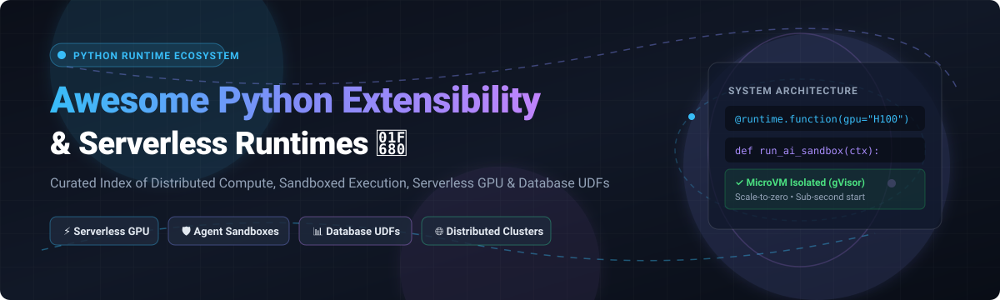

  

# 🚀 Awesome Python Extensibility & Runtime

  
  
  
  
  
  
  

> 🌟 **A curated list of awesome SaaS platforms, open-source frameworks, and developer tools for Python Extensibility, Serverless GPU Runtimes, Database UDFs, AI Agent Sandboxes, and Distributed Task Compute.**

---

## 📌 Executive Summary & Key Highlights

This repository tracks notable **SaaS platforms** and **open-source projects** enabling organizations and developers to execute Python code in secure, scalable, and isolated cloud runtime environments. Key capabilities covered include:
- ⚡ **Serverless GPU Compute & MicroVMs:** Instant zero-cold-start execution of modern AI models and LLMs (Modal, Beam, Replicate).
- 🛡️ **AI Agent Code Sandboxes:** MicroVM and gVisor sandboxing for autonomous agents executing untrusted code securely.
- 📊 **Database Python UDFs & In-Database Runtimes:** Embedded Python analytics inside Snowflake, Databricks PySpark, and TiDB.
- 🌐 **Distributed Task Queues & Cluster Orchestration:** Scaling parallel compute across hundreds of nodes (Ray, Dask, Celery, SkyPilot).
- 🧩 **Extensible Plugin Architectures:** Frameworks supporting dynamic runtime plugins and sandboxed modular extensibility.

---

## 📑 Table of Contents

- [📈 Sector Overview & Market Dynamics](#-sector-overview--market-dynamics)
- [☁️ SaaS & Hosted Platforms](#️-saas--hosted-platforms)
- [💻 Open-Source GitHub Projects](#-open-source-github-projects)
- [🌟 Star History](#-star-history)
- [🤝 How to Contribute](#-how-to-contribute)
- [💖 Support & Sponsorship](#-support--sponsorship)
- [⚠️ Disclaimer](#️-disclaimer)

---

## 📈 Sector Overview & Market Dynamics

The global serverless compute and cloud runtime market is valued between **$26B and $32B for 2025–2026**, growing at a **~22% CAGR** propelled by enterprise AI transformations, serverless GPU inference demands, and agentic code execution sandboxes.

The market landscape is **moderately concentrated** at the infrastructure layer—where tier-1 cloud hyperscalers (*AWS*, *Microsoft Azure*, *Google Cloud*) and data lakehouse giants (*Databricks*, *Snowflake*) capture the core enterprise workload volumes. Simultaneously, the ecosystem is **highly fragmented and dynamic** across specialized AI runtime layers: next-generation serverless platforms like *Modal*, *Beam (Beta9)*, and *Ray* environments compete vigorously by offering sub-second cold starts, dynamic GPU pooling, and Python-native execution primitives.

---

## ☁️ SaaS & Hosted Platforms

| Platform | Company Valuation / Scale | Starting Tier Pricing | Free Tier / Trial Limits | Key Capabilities & Description |
| :--- | :--- | :--- | :--- | :--- |
| **[Microsoft Azure Functions Python](https://azure.microsoft.com/en-us/products/functions)** | 🏢 ~$3.1T Market Cap | $0.20 per 1M executions + $0.000016/GB-s (Consumption plan) | 🎁 **1,000,000 executions & 400,000 GB-s free per month** (Always Free tier) | Enterprise event-driven serverless compute running Python with rich triggers and native Azure service integrations. |
| **[Google Cloud Functions Python](https://cloud.google.com/functions)** | 🏢 ~$2.1T Market Cap (Alphabet) | $0.40 per 1M invocations + $0.0000025/GHz-s & $0.00000125/GB-s | 🎁 **2,000,000 invocations, 400,000 GB-s, and 5 GB egress free per month** (Always Free tier) | Scalable FaaS offering Python execution backed by Google Cloud Run infrastructure, Cloud Storage, and Pub/Sub triggers. |
| **[AWS Lambda Python](https://aws.amazon.com/lambda/)** | 🏢 ~$2.0T Market Cap (Amazon) | $0.20 per 1M requests + $0.0000166667/GB-s ($0.0000133334 for ARM) | 🎁 **1,000,000 requests & 400,000 GB-seconds free per month** (Always Free tier) | The industry-standard serverless execution runtime; auto-scales Python functions with event triggers and micro-billing. |
| **[Databricks PySpark](https://docs.databricks.com/)** | 🦄 ~$134B Valuation ($4.8B ARR) | ~$0.07 to $0.55 per DBU (Standard/Premium compute tier) | ⏳ **14-day free trial** with complimentary trial compute credits (cloud infrastructure billed via cloud provider) | Unified Data & AI Lakehouse runtime executing Python/Pandas UDFs governed securely under Unity Catalog. |
| **[Snowflake Python UDFs](https://docs.snowflake.com/)** | 🏢 ~$110B Market Cap | $2.00 per Snowflake Credit (Standard Edition on-demand) | ⏳ **30-day free trial with $400 in free usage credits** (no credit card required upfront) | Sandboxed in-database Python runtime for running custom transformations, Pandas UDFs, and Snowpark procedures. |
| **[Modal](https://modal.com/)** | 🦄 $15.75B Valuation ($1B ARR) | $0.000164/sec (~$0.59/hr for T4 GPU) on Starter ($250/mo for Team) | 🎁 **$30 in free compute credits every month** (Renews monthly; supports up to 10 GPU concurrency) | High-performance serverless Python container runtime optimized for GPU workloads and secure AI agent code sandboxes. |
| **[Ray on Anyscale](https://www.anyscale.com/)** | 🤝 $1.65B Valuation (Acquired by Nscale) | ~$0.0135/hr (CPU) to $0.5682/hr (T4 GPU) via Anyscale Credits | 🎁 **$100 in free starting compute credits** for new user onboarding and test workloads | Managed Ray platform built by Ray creators for distributed model training, batch inference, and Ray Serve deployments. |
| **[Streamlit Cloud](https://streamlit.io/)** | 🤝 $800M Valuation (Acquired by Snowflake) | Free for Community; enterprise access via Streamlit in Snowflake | 🎁 **Free forever plan** with unlimited public apps, 1 private app, and 2.7 GB RAM per container | Cloud hosting platform deploying interactive Python data apps and dashboards directly from a GitHub repository. |
| **[Replicate](https://replicate.com/)** | 🤝 ~$350M Valuation (Acquired by Cloudflare) | $0.000225/sec (~$0.81/hr for T4) or model token-based billing | ⏳ **1 request/sec (max 6 req/min)** rate limit on promotional signup trial credits | Cloud model inference platform deploying open-source Python AI containers via `cog` with per-second billing. |
| **[Coiled](https://coiled.io/)** | 💼 ~$100M Valuation ($26M Raised) | $0.05 per CPU-hour management fee beyond free tier | 🎁 **500 CPU-hours free per month** when connecting your AWS/GCP/Azure account (200 CPU-hrs on hosted) | Managed serverless Dask runtime spinning up elastic distributed Python clusters across multi-cloud environments. |

---

## 💻 Open-Source GitHub Projects

| Project | Stars | Category & Architecture Highlights |
| :--- | :--- | :--- |
| **[FastAPI](https://github.com/tiangolo/fastapi)** |  | ⚡ High-performance, async Python web and API framework heavily leveraged as the entry runtime for microservices and function serving. |
| **[vLLM](https://github.com/vllm-project/vllm)** |  | 🚀 High-throughput, memory-efficient LLM serving and inference runtime engine featuring PagedAttention and Python execution hooks. |
| **[Ray](https://github.com/ray-project/ray)** |  | 🌐 Unified distributed compute framework for scaling AI and Python workloads; includes Ray Serve for model serving and Ray Train for distributed training. |
| **[Celery](https://github.com/celery/celery)** |  | 📬 Distributed task queue and asynchronous execution runtime for Python applications, handling millions of background tasks and jobs. |
| **[OpenFaaS](https://github.com/openfaas/faas)** |  | ☁️ Serverless Functions-as-a-Service framework on Docker and Kubernetes with rich Python runtime templates and auto-scaling. |
| **[Prefect](https://github.com/prefecthq/prefect)** |  | 🔄 Modern workflow orchestration engine coordinating complex, distributed Python task pipelines with dynamic runtime state management. |
| **[Dask](https://github.com/dask/dask)** |  | 📊 Flexible library for parallel computing and scalable distributed execution across NumPy, pandas, and custom Python graphs. |
| **[SkyPilot](https://github.com/skypilot-org/skypilot)** |  | ✈️ Framework for seamlessly running Python AI and batch workloads across multiple clouds and GPUs, maximizing cost efficiency. |
| **[BentoML](https://github.com/bentoml/bentoml)** |  | 🍱 Unified model serving and AI application runtime for shipping, containerizing, and scaling production Python inference services. |
| **[Litestar](https://github.com/litestar-org/litestar)** |  | 🛠️ Production-grade, asynchronous ASGI Python framework built with high extensibility, dependency injection, and plugin architectures. |
| **[Beam (Beta9)](https://github.com/beam-cloud/beta9)** |  | 🏎️ Open-source serverless GPU runtime and Modal alternative featuring checkpoint restore, gVisor isolation, and decorator-based deployments. |
| **[Modal Client](https://github.com/modal-labs/modal-client)** |  | 🔌 Official open-source client SDK for defining, orchestrating, and dispatching Python functions to serverless cloud infrastructure. |
| **[XCore](https://github.com/traoreera/xcore)** |  | 🛡️ Extensible plugin-first orchestration runtime built on FastAPI featuring AST-based scanning, resource isolation, and hot reloading. |

---

## 🌟 Star History

---

## 💖 Support & Sponsorship

If you find this repository valuable for your projects, architecture design, or research, please consider supporting the project:

- ⭐ **Star this repository** to help others discover it!
- 🍴 **Fork and share** it with your fellow engineers, data scientists, and DevOps colleagues.
- ☕ **Buy a coffee or sponsor the project**: Your support helps maintain and update open-source developer resources:  
  

A huge thank you to all contributors, stargazers, and sponsors for keeping this ecosystem guide fresh and up-to-date! 🙌

---

## 🤝 How to Contribute

Contributions are always welcome! Here is how you can help expand this list:

1. 🍴 **Fork the repository**.
2. 🌿 **Create a new branch** (`git checkout -b feature/add-new-runtime`).
3. 📝 **Add/edit entries in `README.md`** following the existing table formatting.
4. 🔍 **Ensure entries include**: Official website/repo link, verified starting pricing/limits, star count, and a concise technical description.
5. 🚀 **Submit a Pull Request** with a brief summary of the added runtime or platform.

---

## ⚠️ Disclaimer

- This list is **community-curated** for educational, architectural, and informational purposes—inclusion does not constitute an endorsement.
- Organizations deploying Python runtimes for untrusted code execution must establish proper sandboxing, gVisor/microVM isolation, memory protection, and patching policies.
- Pricing, free tier limits, and corporate valuations change frequently; please verify current details with official cloud vendor documentation before committing production workloads.
- Check open-source licenses for specific commercial terms and conditions.

---

  <b>Built with ❤️ for Python engineers, cloud architects, and platform teams worldwide.</b>

